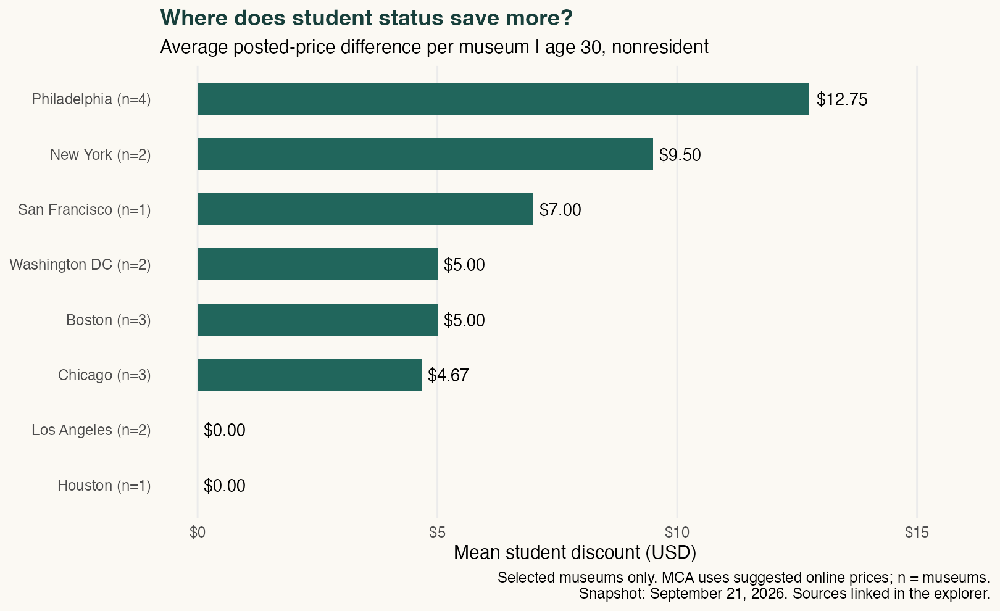
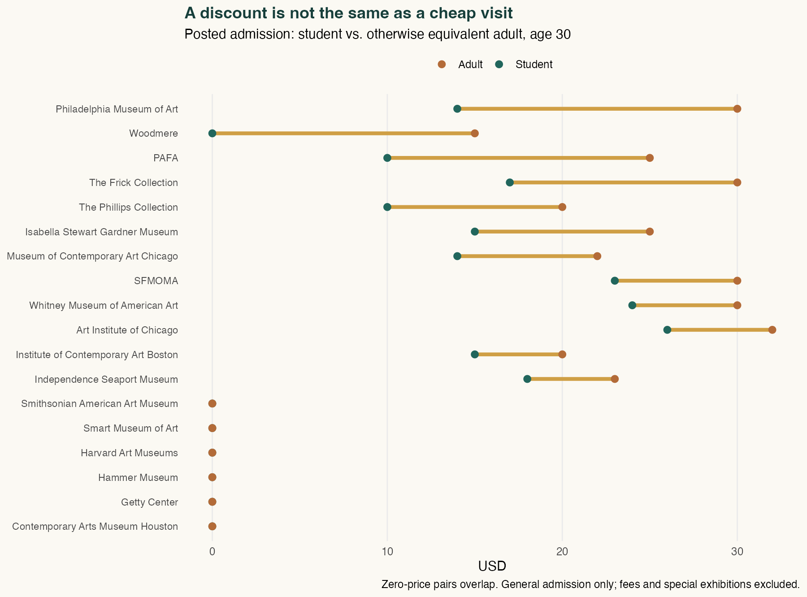

```{r}
invisible(capture.output(source('analyze.R',local=TRUE)))
usd <- function(x) sprintf('$%.2f',x)
ph <- subset(city,city=='Philadelphia')
ny <- subset(city,city=='New York')
pair <- subset(d,id %in% c('pma','pafa'))
wood <- subset(d,id=='woodmere')
whit <- subset(d,id=='whitney')
frick <- subset(d,id=='frick')
```

::: {.story-deck}
<span class="eyebrow">BLOG 2 · DATA IN EVERYDAY LIFE</span>

**For two Philadelphia museum visits in this snapshot, a student ID cuts the admission bill by `r usd(sum(pair$saving))`. At the Whitney, the card's value depends on your age.**

18 museums · 8 cities · September 21, 2026 price snapshot
:::

## What does the card actually save?

You have chosen a museum. Is it worth finding your student ID before leaving home? To answer that practical question, I used R's **rvest** package to collect official admission information for 18 museums across eight U.S. cities. The comparison holds the visit and visitor's age constant: what does a student pay, compared with an otherwise equivalent nonstudent?

That distinction matters. A museum that admits everyone free offers no extra student discount. A youth ticket available to nonstudents is not a benefit of enrollment. I therefore measure **student-ID saving as the adult price minus the student price at the same age**.

The baseline is a 30-year-old, nonresident, full-time college student with valid ID. Age 30 separates student eligibility from youth offers; the explorer also compares 22-year-olds. School partnerships, residency benefits, memberships, fees, parking, and separately ticketed exhibitions are excluded.

## Where forgetting your ID costs more



Philadelphia's average saving is **`r usd(ph$saving)` per sampled museum**, compared with **`r usd(ny$saving)`** in New York. This is a comparison of selected institutions, not evidence that Philadelphia is the best city for every student: the sample includes four Philadelphia museums but only two in New York, and some cities include free museums.

The individual prices are more useful for a decision. At the [Philadelphia Museum of Art](https://www.philamuseum.org/main-building) and [PAFA](https://www.pafa.org/museum/visit), the recorded student tickets total **`r usd(sum(pair$student))`**, versus **`r usd(sum(pair$adult))`** at adult rates. If you already plan to visit both on regular admission days, using your student ID saves **`r usd(sum(pair$saving))`**. This is a two-visit budget, not a suggested one-day itinerary.

At [Woodmere](https://woodmeremuseum.org/visit), the snapshot lists **`r usd(wood$student)` for students versus `r usd(wood$adult)` for adults**. Here, the card eliminates the general-admission charge. On its recorded free Sundays, however, both groups enter free: the additional student saving is zero. The discount matters on an ordinary paid day, not equally on every visit.

## Same museum, different age, different benefit



At the [Whitney](https://whitney.org/visit), the baseline student price is **`r usd(whit$student)` rather than `r usd(whit$adult)`**: a **`r usd(whit$saving)`** student discount. But visitors 25 and under qualified for free admission regardless of enrollment. For a 22-year-old, the comparison becomes zero against zero. Being a student contributes no additional saving there.

Switching both groups to age 22 reduces New York's mean student-ID saving from **`r usd(ny$saving)` to `r usd(ny$saving22)`**. That does not mean young students pay more; it means part of their benefit comes from age rather than student status. The [Frick's](https://www.frick.org/visit) recorded student discount, **`r usd(frick$saving)`**, remains relevant in that scenario.

## Before your next museum visit

**Bring your ID when the regular student rate is below the rate you otherwise qualify for.** For the PMA–PAFA pair, this snapshot puts that benefit at **`r usd(sum(pair$saving))`**. At Woodmere on a paid day it is **`r usd(wood$saving)`**; at the Whitney for a 22-year-old it is zero. These are specific savings on the same visits, rather than reasons to travel to a different city.

Use the explorer to select your city and age, compare the “Saving” column, and check the official eligibility link before buying. Free hours and pay-what-you-can options may lower both prices; MCA Chicago's displayed online rates are not mandatory in-person charges. **These are historical observations, not current ticket quotes.**

## Check your museums

```{=html}

```

## How to check and reproduce the results

I screened 30 institutions, retaining 18 with comparable, extractable prices. rvest parses cached official price text; reviewed patterns identify ticket categories. Required categories must be present, and missing prices never become zeros. Requests were spaced and cached; access failures and restrictive terms led to exclusions. This convenience sample, mostly art museums, cannot establish representative city rankings.

[File guide and replication instructions](https://github.com/lizzyuan77/lizzyuan-s-website/tree/main/blog/posts/post2#readme) explain the source list, exclusions, and limits of the short evidence extracts. One offline R command regenerates the CSVs, figures, and explorer from that evidence.

[Download the data](data/derived/museum_prices.csv){.btn .btn-outline-primary}
[Download code and evidence](research.zip){.btn .btn-outline-primary}

*AI assistance supported coding, drafting, and checking extraction rules. Source links and collection records accompany the data.*
