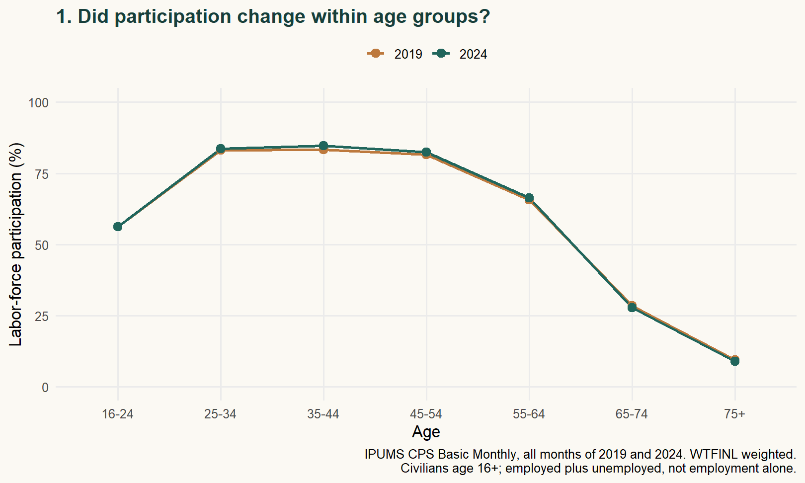
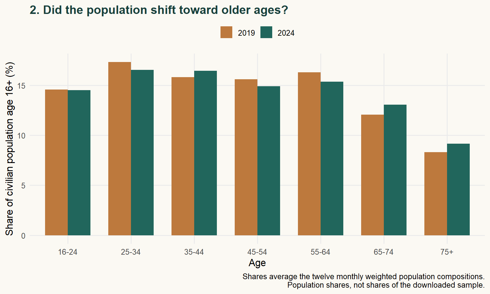
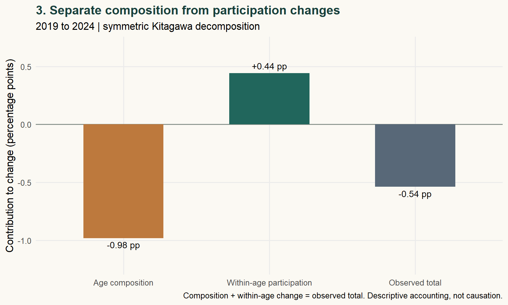

```{r}
r <- readRDS('results/analysis.rds')
pct <- function(x) sprintf('%.2f%%',100*x)
pp <- function(x) sprintf('%.2f',x)
g0 <- subset(r$groups,YEAR==2019)
g1 <- subset(r$groups,YEAR==2024)
g1 <- g1[match(g0$age_group,g1$age_group),]
rate <- function(age,year) pct(subset(r$groups,age_group==age & YEAR==year)$rate)
older <- function(year) pct(sum(subset(r$groups,YEAR==year & age_group %in% c('65-74','75+'))$share))
sens <- read.csv('results/sensitivity.csv')
example <- subset(r$decomposition,age_group=='35-44')$within
```

::: {.callout-note}
**BLOG 3 · THE PEOPLE BEHIND THE AVERAGE**

Participation fell **`r pp(abs(r$delta))` percentage points**. A shift toward older ages pulled it down; changes within age groups partly offset the decline.
:::

## Can participation improve while the national rate falls?

Can population aging explain falling participation despite gains among younger adults? In IPUMS CPS data, weighted participation fell from **`r pct(r$annual$rate[1])` to `r pct(r$annual$rate[2])`** between 2019 and 2024. Participation includes working people and unemployed jobseekers, unlike an employment rate.

## Compare like ages, then count their shares

Figure 1 shows participation rising in all five displayed age groups below 65. For ages 35–44, it increased from **`r rate('35-44',2019)` to `r rate('35-44',2024)`**. Among ages 65–74, it fell from **`r rate('65-74',2019)` to `r rate('65-74',2024)`**. These comparisons do not follow the same people as they age.

{fig-alt="2019 and 2024 labor-force participation by age. Rates rise below 65 and decline at ages 65–74 and 75+."}

Figure 2 shows adults 65 and older growing from **`r older(2019)` to `r older(2024)`** of the weighted population. Moving population weight toward groups with lower participation can pull down the average, even without any change in their participation rates.

{fig-alt="Weighted population shares by age in 2019 and 2024; both groups aged 65 and older increase."}

## How the decomposition separates the changes

The idea is to separate **who makes up the population** from **how likely people of each age are to work or look for work**. The method is called a **symmetric Kitagawa decomposition**.

Start with an **imaginary population of 100 adults**: 60 younger and 40 older. If 80% of the younger group and 20% of the older group participate, there are $60\times0.80+40\times0.20=56$ participants. The overall rate is 56%.

The first formula expresses that same calculation:

$$
P_t=\sum_g s_{g,t}p_{g,t}.
$$

Read it as **“multiply each group's share of the population by its participation rate, then add the answers.”** The symbols are shorthand:

- $P$: the overall participation rate; $s$: a group's population share; $p$: its participation rate.
- $g$: the age group; $t$: the year. The subscripts are labels, not multiplication.
- $\sum_g$: “add up all age groups.” Write 60% as 0.60 when calculating.

Now imagine the population becomes 50 younger and 50 older adults, with both groups' participation rates unchanged. The total becomes $50\times0.80+50\times0.20=50$ participants. Participation falls from 56% to 50% **entirely because the age mix changed**. Nobody in either group became less likely to participate.

In the real data, both shares and participation rates change. The next formulas separate their contributions. Here $0$ means 2019, $1$ means 2024, and $\Delta$ means “change”:

$$
\begin{aligned}
\Delta P &= P_1-P_0=C+W,\\[4pt]
C &= \sum_g(s_{g,1}-s_{g,0})\frac{p_{g,1}+p_{g,0}}{2},\\[4pt]
W &= \sum_g(p_{g,1}-p_{g,0})\frac{s_{g,1}+s_{g,0}}{2}.
\end{aligned}
$$

**Read $C$ as “the age-mix contribution.”** For each group, subtract its old share from its new share, multiply by its average participation rate across the two years, then add across groups. In our imaginary example, $C$ is −6 percentage points.

**Read $W$ as “the participation-within-groups contribution.”** For each group, subtract its old participation rate from its new rate, multiply by its average population share, then add. In our example, $W$ is zero because neither group's participation rate changed.

Each fraction adds the two years' values and divides by two: an ordinary average. Using both years is what makes the method **symmetric**, rather than favoring one reference year. The contributions add exactly to the overall change. Multiply the formula's results by 100 for percentage points: moving from 56% to 50% is a fall of six points.

In the CPS results, ages 35–44 contribute **+`r pp(example)` points** to $W$: their participation increase is multiplied by their average population share. Figure 3 adds contributions from all seven age groups.

## What the components reveal

{fig-alt="Symmetric decomposition: age composition −0.98, within-age participation +0.44, total −0.54 percentage points."}

Figure 3 adds the components: **`r pp(r$composition)` + `r pp(r$within)` = `r pp(r$delta)` percentage points**. Changes in age composition outweigh the decline; within-age gains partly offset them. Narrower age bins give the same interpretation.

The economic intuition is that participation falls at retirement ages. [Aaronson and colleagues (2014)](https://www.federalreserve.gov/pubs/feds/2014/201464/201464pap.pdf) distinguish population aging from participation declines associated with weak demand for workers. [Montes, Smith, and Dajon (2022)](https://www.federalreserve.gov/econres/feds/the-great-retirement-boom.htm) distinguish aging from unusually early pandemic retirements. This age-only decomposition cannot identify those individual retirement decisions.

**Judge recovery using age-group participation alongside the headline rate.** Returning to 2019's overall rate is a different benchmark when the population is older. The headline decline alone does not establish widespread withdrawal from work or reveal why participation changed.

## Data and reproduction

I use twelve Basic Monthly CPS samples per year: **`r format(tail(r$audit$n,1),big.mark=',')` eligible person-month observations** of civilians age 16+. Respondents can appear repeatedly.

All estimates use **WTFINL** person weights, normalized so each month contributes equally. Group shares and rates use consistent weights. Results are not seasonally adjusted; population-control revisions can affect comparisons. No significance claims are made.

Source: [IPUMS CPS Version 13.0](https://doi.org/10.18128/D030.V13.0), University of Minnesota; Basic Monthly samples, 2019 and 2024. Method: [Kitagawa (1955)](https://doi.org/10.1080/01621459.1955.10501299).

[Download code and aggregate results](research.zip). The [README](https://github.com/lizzyuan77/lizzyuan-s-website/tree/main/blog/posts/post3#readme) gives the run order. Obtain raw microdata separately through IPUMS.
