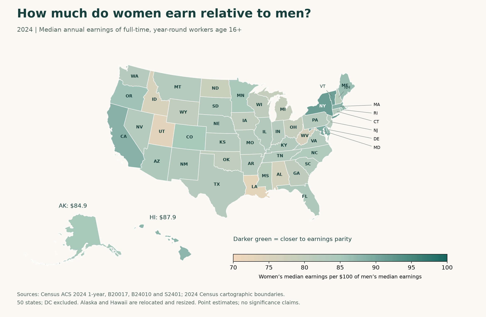
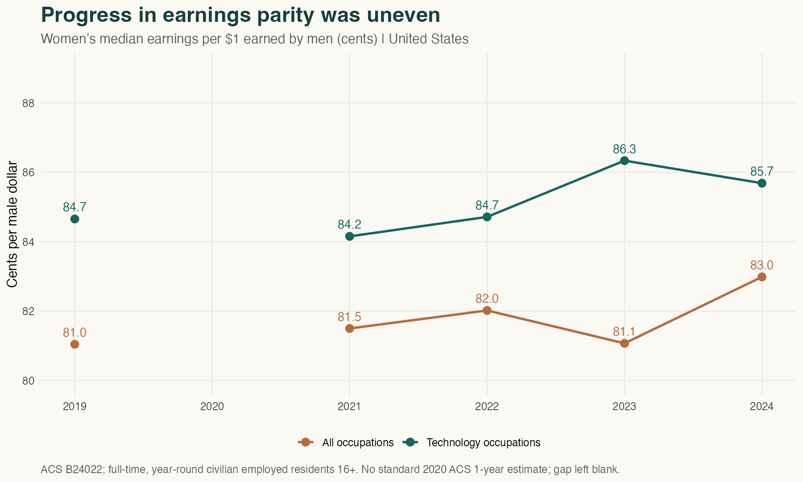
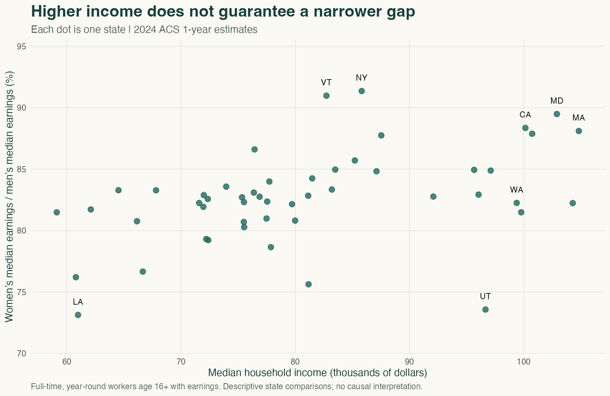
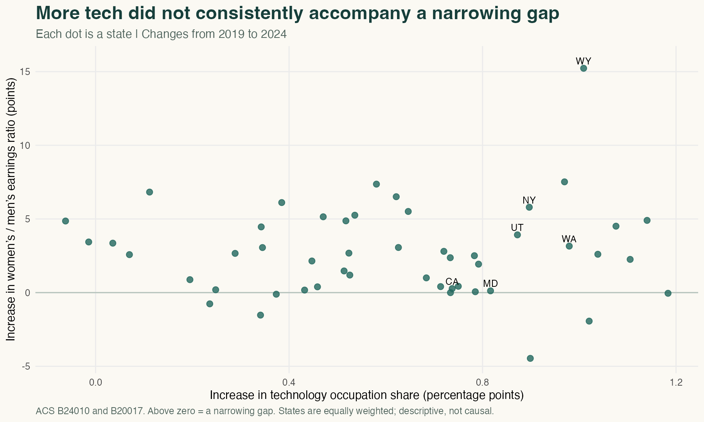
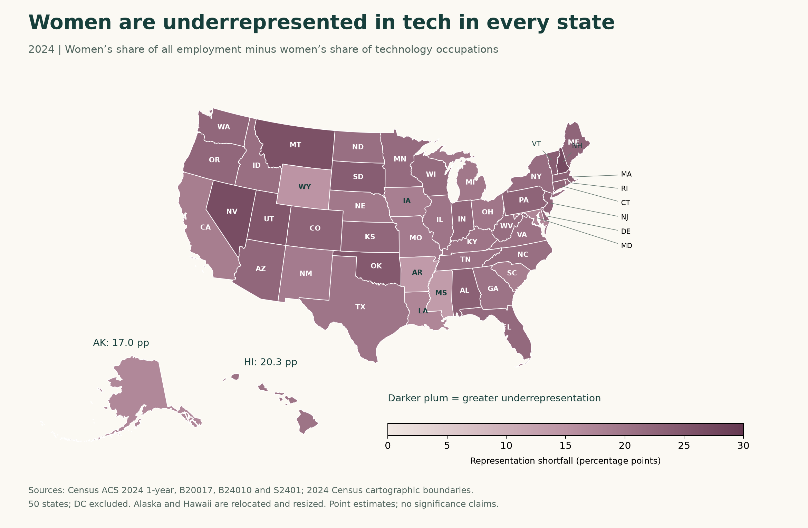
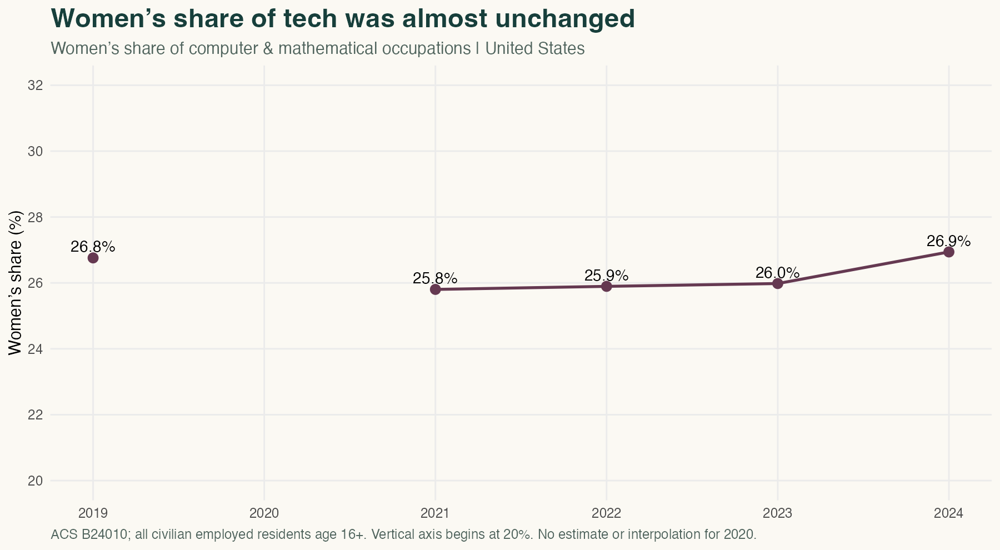
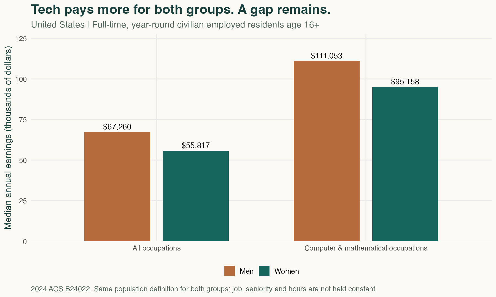

```{r}
z <- read.csv('results/states-expanded.csv',colClasses=c(state='character'))
us <- read.csv('results/national.csv')
corr <- read.csv('results/mechanism-correlations.csv')
trend <- read.csv('results/national-trends.csv')
change <- read.csv('results/state-trend-changes.csv')
trend_corr <- read.csv('results/trend-correlations.csv')
tv <- function(year,k) trend[trend$year==year,k]
v <- function(s,k) z[z$NAME==s,k]
cval <- function(s) corr$value[corr$check==s]
one <- function(x) sprintf('%.1f',x)
two <- function(x) sprintf('%.2f',x)
dollar <- function(x) paste0('$',format(round(x),big.mark=',',trim=TRUE))
```

A lucrative career can carry a cost that never appears on a pay stub: control over one's time.

That trade-off sits at the center of economist [**Claudia Goldin's** explanation](https://dash.harvard.edu/entities/publication/7d2a495a-0223-42b2-b319-00df2981d85a) for why gender earnings gaps persist. Jobs can reward long, inflexible hours disproportionately. When someone must also be available for a child or an aging parent, a household faces a costly choice over whose career bends. The consequences can accumulate even when partners begin with similar qualifications. Goldin received the [2023 Nobel Memorial Prize in Economic Sciences](https://www.nobelprize.org/prizes/economic-sciences/2023/press-release/) for her research on women's labor market outcomes.

Her work suggests a question for the modern technology economy. Does creating more well-paid technical work make a place more equal—or does equality depend on who gets those jobs and how careers are organized?

Five years of Census estimates—**2019 and 2021–2024**—give a complicated answer. Technology occupations offer high earnings for women and men. But tech's expanding footprint has not brought a comparable increase in women's representation. A state's concentration of technical workers also says surprisingly little about either its current earnings gap or how much that gap narrowed.

## First, look at where the gap is widest

In Washington, a center of the technology economy, women working full time, year round had median annual earnings equal to **`r one(v('Washington','ratio'))` cents per dollar earned by men**. In Maryland, another state with a similar concentration of technical workers, the figure was **`r one(v('Maryland','ratio'))` cents**.

The difference is substantial enough to challenge a simple story in which more technology jobs automatically produce equal outcomes.

{fig-alt="Map of female-to-male median annual earnings across 50 states in 2024. Ratios range from about 73 cents per dollar in Louisiana to 91 cents in New York. Alaska and Hawaii appear as labeled insets."}

Across the 50 states, women's median earnings were below men's everywhere. New York and Vermont had the highest point estimates, around **`r one(v('New York','ratio'))` and `r one(v('Vermont','ratio'))` cents** per dollar. Louisiana and Utah were near **`r one(v('Louisiana','ratio'))` and `r one(v('Utah','ratio'))` cents**. Small differences in these estimated rankings should not be treated as statistically established.

The geography matters because similar technology economies do not produce similar earnings outcomes. Washington and Maryland each have roughly **`r one(v('Washington','tech_share'))`% and `r one(v('Maryland','tech_share'))`%** of employed residents in computer and mathematical occupations, yet their earnings ratios differ by **`r one(v('Maryland','ratio')-v('Washington','ratio'))` cents**. Technology's presence alone cannot account for that contrast. California and Massachusetts also have relatively small gaps, while Utah combines a substantial technical workforce with one of the widest gaps. The map therefore points us toward the composition of local labor markets and access to their opportunities, rather than a simple divide between technology centers and everywhere else.

These figures compare the medians of women and men age 16 or older who worked full time, year round. They are **earnings gaps**, not evidence that a woman and a man doing the same job receive those different paychecks. Occupations, seniority, hours within full-time work, and self-employment can all differ. People working part time or outside paid work are not included.

## Did the gap at least narrow over time?

Nationally, yes—but unevenly. Among full-time, year-round civilian employed residents, women's median earnings across all occupations rose from **`r one(tv(2019,'matched_ratio'))` cents per male dollar in 2019 to `r one(tv(2024,'matched_ratio'))` cents in 2024**. In technology occupations, the ratio moved from **`r one(tv(2019,'tech_ratio'))` to `r one(tv(2024,'tech_ratio'))` cents**. Neither series shows steady progress at every observation.

::: {.callout-note title="Why is 2020 missing?"}
COVID-19 disrupted American Community Survey data collection, creating response problems and nonresponse bias. The resulting estimates did not meet Census's quality standards, so it **did not release the standard 2020 ACS one-year estimates**. Census instead released experimental estimates using a different weighting approach. To keep this comparison consistent, the charts leave 2020 blank rather than mix those products or invent a value. [Read the Census explanation](https://www.census.gov/programs-surveys/acs/technical-documentation/user-notes/2021-02.html).
:::

{fig-alt="Two national lines show female-to-male earnings ratios in all occupations and technology in 2019 and 2021 through 2024. Both end higher than in 2019, but fluctuate. No point or connecting line fills the missing year 2020."}

Across states, **`r sum(change$overall_ratio_change>0)` of 50** had a higher overall earnings-ratio point estimate in 2024 than in 2019. That is evidence of a broad descriptive improvement, not a finding that every measured change is statistically significant. These are repeated snapshots of residents, not the same workers followed through their careers.

The comparison spans the pandemic and changes in who was employed; it cannot isolate a technology effect from those changes.

## Is prosperity doing more of the work than technology?

Higher-income states generally have smaller gaps. Across states, the correlation between median household income and women's earnings relative to men's is **`r two(cval('income_ratio'))`**. The correlation with technology concentration is weaker, **`r two(cval('tech_ratio'))`**. Here, technology means computer and mathematical occupations as a share of employed residents—not all employees of technology companies.

{fig-alt="Scatterplot comparing state median household income with female-to-male median earnings. Utah has high household income but a much lower earnings ratio than many states with similar income."}

The two features overlap: states with more technical workers also tend to have higher household incomes. To separate those patterns descriptively, I remove each variable's linear relationship with household income and compare what remains. The technology–earnings-ratio correlation falls to **`r two(cval('tech_ratio_holding_income'))`**, essentially zero.

That is a useful check on the original comparison, not proof that income explains the gap. Household income itself reflects earnings, household composition and other income sources. It is not an outside force randomly assigned to states. Nor is it wealth, which measures accumulated assets minus debts.

Utah illustrates the limits of prosperity as an explanation. Its median household income was **`r dollar(v('Utah','income'))`**, higher than New York's **`r dollar(v('New York','income'))`**, yet its earnings ratio was much lower. A high household income does not tell us whether two earners contribute equally to it.

The time comparison provides another test. Technology's national employment share rose from **`r one(tv(2019,'tech_share'))`% to `r one(tv(2024,'tech_share'))`%**. Increases occurred in **`r sum(change$tech_share_change>0)` of 50 states**. Yet states with larger increases did not consistently see larger improvements in earnings parity: the correlation between those two changes is only **`r two(trend_corr$pearson[trend_corr$check=='tech_growth_gap_narrowing'])`**. Rank correlation is also near zero.

{fig-alt="A 50-state scatterplot compares changes in technology employment shares with changes in female-to-male earnings ratios between 2019 and 2024. The correlation is about zero. Points above the horizontal zero line indicate a narrowing earnings gap."}

This separates a geographic pattern from a change over time. A tech-rich state can look different from a less technical state, yet expanding its technical workforce does not necessarily move its overall earnings ratio in the same direction. The comparison remains descriptive: migration and changes in other industries can affect both measures.

## Who gets the technology jobs?

Nationally, women held **`r one(us$women_workforce)`% of all employed jobs**, but only **`r one(us$women_tech)`% of computer and mathematical jobs**. Put another way, **`r one(us$female_tech_rate)`% of employed women** worked in those occupations, compared with **`r one(us$male_tech_rate)`% of employed men**.

The relevant question is therefore not only how many technical jobs a state has. It is whether women share in them.

{fig-alt="State map of the percentage-point difference between women’s share of all employed workers and women’s share of computer and mathematical workers. All 50 estimates show underrepresentation in technology."}

In Washington, women held **`r one(v('Washington','women_tech'))`%** of technology occupations, compared with **`r one(v('Washington','women_workforce'))`%** of all employed jobs. Maryland's corresponding shares were **`r one(v('Maryland','women_tech'))`%** and **`r one(v('Maryland','women_workforce'))`%**. Utah's tech workforce was only **`r one(v('Utah','women_tech'))`%** women.

Reading the two maps together sharpens that explanation. Maryland's smaller earnings gap coincides with a smaller shortfall in women's technology representation than Washington's: **`r one(v('Maryland','representation_shortfall'))` versus `r one(v('Washington','representation_shortfall'))` percentage points**. Utah pairs a wide earnings gap with an especially male-dominated technical workforce. These comparisons are consistent with occupational access being one channel through which a prosperous economy can distribute its rewards unevenly. They do not establish that channel's size or cause.

Louisiana provides a revealing counterexample. Women hold **`r one(v('Louisiana','women_tech'))`%** of its technical jobs, close to Maryland's share, but the state has the lowest overall earnings-ratio point estimate. Technical occupations account for only **`r one(v('Louisiana','tech_share'))`%** of employed Louisiana residents. Better representation in a small part of an economy cannot describe opportunities for the much larger workforce outside it. The maps reveal two distinct questions: who participates in well-paid technical work, and what happens across the rest of the local economy.

Over time, women's national share of technical occupations was almost unchanged: **`r one(tv(2019,'women_tech'))`% in 2019 and `r one(tv(2024,'women_tech'))`% in 2024**, with lower estimates in between. The field grew, but its gender composition barely shifted between the endpoints. At the state level, women's tech representation rose in **`r sum(change$women_tech_change>0)` states** and fell in the others.

{fig-alt="Women’s national share of technology occupations is 26.8 percent in 2019, falls to roughly 25.8–26.0 percent during 2021–2023, and reaches 26.9 percent in 2024. The 2020 point is omitted."}

That does not mean women gained no jobs. The estimated number of women in these occupations increased by **`r one(100*(tv(2024,'B24010_E171')/tv(2019,'B24010_E171')-1))`%**. Men also gained jobs, leaving the female share nearly flat. Expanding employment and changing who participates in it are different forms of progress.

This is consistent with an access problem: expanding a well-paid field may disproportionately benefit men when men fill most of its positions. But the data do not reveal whether the imbalance comes from education pathways, hiring, retention, caregiving constraints, workplace culture or other factors. It should not simply be labeled a difference in preferences.

And representation does **not** solve the entire geographic puzzle. Across all states, the correlation between women's share of tech jobs and the overall earnings ratio is just **`r two(cval('women_tech_ratio'))`**. Accounting for household income raises it to **`r two(cval('women_tech_ratio_holding_income'))`**, still a limited descriptive relationship. New York has a much smaller overall earnings gap than Washington, even though women are a minority of technical workers in both places.

The underrepresentation also persists in all 50 point estimates when I restrict the occupation counts to full-time, year-round workers. Nationally, women are **`r one(us$women_tech_ft)`%** of that technical workforce, versus **`r one(us$women_workforce_ft)`%** of all full-time, year-round employed workers. Part-time employment alone does not account for the pattern.

## Does entering tech eliminate the gap?

It does not. But technology also should not be mistaken for a uniquely unequal field.

Nationally, full-time, year-round women in computer and mathematical occupations had median earnings of **`r dollar(us$tech_female_pay)`**, compared with **`r dollar(us$tech_male_pay)`** for men. That is **`r one(us$tech_pay_ratio)` cents per male dollar**—a narrower gap than the **`r one(us$matched_ratio)` cents** observed across all occupations using the same full-time, year-round civilian employed population.

{fig-alt="Grouped bars show national median annual earnings for women and men in all full-time, year-round civilian employment and in computer and mathematical occupations. Women and men earn more in technology, but women’s median remains lower."}

The geographic contrast survives inside the broad category. In Washington, women's median tech earnings were **`r one(v('Washington','tech_pay_ratio'))`%** of men's; in Maryland, **`r one(v('Maryland','tech_pay_ratio'))`%**. This still does not compare identical jobs. A software developer and a computer support specialist can share the same broad occupational label while earning very different amounts. Experience, management responsibilities and hours can differ too.

That distinction helps explain why both access and careers matter. More women entering a high-paying field could broaden opportunity. But entry alone need not equalize promotions, specialties, hours or pay. Conversely, a relatively small gap inside tech cannot determine a state's overall gap: even in Washington, these occupations account for only **`r one(v('Washington','tech_share'))`%** of employed residents. Most workers are elsewhere in the economy.

Nor can the overall median be decomposed into a weighted average of occupational medians. These comparisons identify patterns worth investigating; they do not calculate the fraction of the state gap caused by occupational sorting.

## What might actually narrow the gap?

Goldin's [2014 research](https://dash.harvard.edu/entities/publication/7d2a495a-0223-42b2-b319-00df2981d85a) points beyond the number of high-paying jobs to the price workers pay for flexibility. If earnings rise disproportionately with long or particular hours, reducing availability can carry a large career cost. Her analysis also found smaller adjusted gaps in technology and science than in business occupations. The lesson is about job design, not a claim that every technology job demands constant availability.

A concrete example comes from [Goldin and Lawrence Katz's research on pharmacy](https://www.nber.org/papers/w18410). They connect its evolution toward family-friendly, well-paid employment to changes in how the profession is organized. When qualified colleagues can substitute for one another, a worker's absence need not interrupt the entire service. That makes flexibility less costly. Technology can help such coordination; its usefulness depends on how employers use it.

For technology employers, that suggests questions about shared project knowledge, reliable handoffs, promotion criteria and whether constant availability is being rewarded over performance. For access, the questions concern training, recruitment and retention. And the [Nobel committee's account of Goldin's research](https://www.nobelprize.org/prizes/economic-sciences/2023/popular-information/_/) highlights how parenthood can redirect earnings trajectories. Childcare and a more balanced division of care are relevant constraints to examine alongside workplace practices.

These are research-informed directions, not interventions evaluated by this state comparison. Testing them would require evidence on workers' jobs, hours, experience and family circumstances over time. The maps cannot establish that childcare costs explain Utah or that flexible work explains Maryland.

Across 2019–2024, technical work expanded without a comparable shift in women's share of it. States with faster tech growth did not consistently narrow their earnings gaps more. A technical economy can pay women well while employing relatively few of them, and a richer state can still have a wide gap. A credible strategy for equality has to ask both **who enters the well-paid jobs and what makes it possible to build a career once there**.

## Data, sources and replication

Estimates use **ACS 1-year data for 2019 and 2021–2024**. The geographic levels, household-income comparisons and detailed earnings bars refer to 2024. B20017 measures the state map's full-time, year-round earnings; B19013 measures household income; S2401 and B24010 measure technology concentration and representation among employed residents; B24020 checks full-time representation in 2024; B24022 supplies occupation earnings and the national earnings trend. Both lines in that trend use B24022's civilian employed universe, which differs from B20017's broader population with earnings. Full time means usually 35+ hours a week; year round means 50–52 weeks.

Only ratios, shares and counts are compared across years; annual dollar medians are not compared without inflation adjustment. The dollar bars and income scatterplot use 2024 dollars without geographic cost-of-living adjustment. The broad occupation definitions are verified against each year's metadata. Changes in population controls, migration, employment selection and demographics still limit comparisons; no change is interpreted as an individual worker's earnings gain.

State averages can also conceal a divide between a technology center and surrounding communities. These estimates describe residents, not the location of employers; they cannot tell us whether an apparent state advantage reaches rural counties or workers outside a metropolitan hub. A county or metropolitan comparison would be the next step for testing that geographic reach. No formal test of neighboring-state clustering is conducted here.

The maps join [Census state boundaries](https://www2.census.gov/geo/tiger/GENZ2024/shp/cb_2024_us_state_20m.zip) to estimates by FIPS code. State comparisons exclude DC and Puerto Rico and weight each state equally. The national results use the actual U.S. tabulation. Census estimates already use survey weights. Published margins of error are retained; charts show point estimates without significance claims. Sex is tabulated as male/female and does not describe all gender identities. Age, race, education and differences within states remain unadjusted.

[Download all state comparisons](results/states-expanded.csv) · [Download the reproducibility package](research.zip) · [Code and replication instructions](https://github.com/lizzyuan77/lizzyuan-s-website/tree/main/blog/posts/post5)

[Download the 250 state-year observations](results/state-trends.csv) · [Download the national trends](results/national-trends.csv)

Public Census earnings, income and occupation [summary files](https://www.census.gov/programs-surveys/acs/data/summary-file.2024.html) retrieved October 19, 2026. S2401 uses the repository's October 4 download of the same release. Research references: Goldin (2014), *American Economic Review*, [doi:10.1257/aer.104.4.1091](https://doi.org/10.1257/aer.104.4.1091); Goldin and Katz (2016), *Journal of Labor Economics*, [doi:10.1086/685505](https://doi.org/10.1086/685505), with an open [working paper](https://www.nber.org/papers/w18410).
