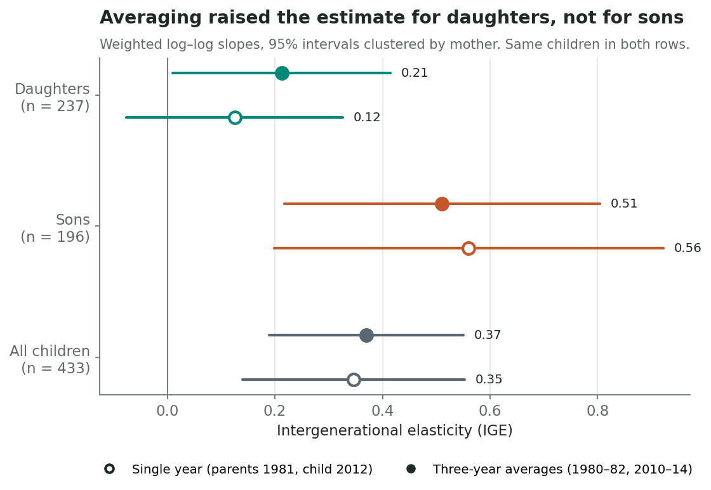
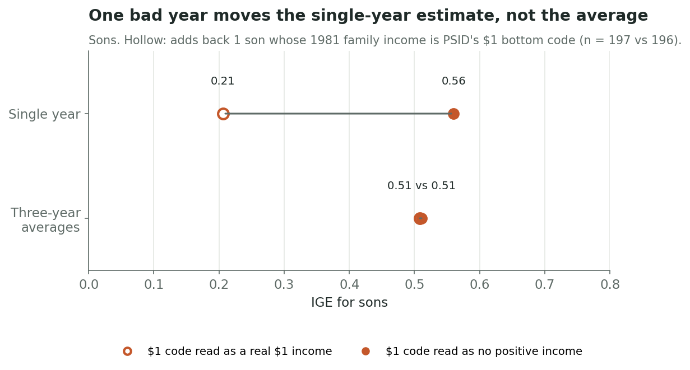
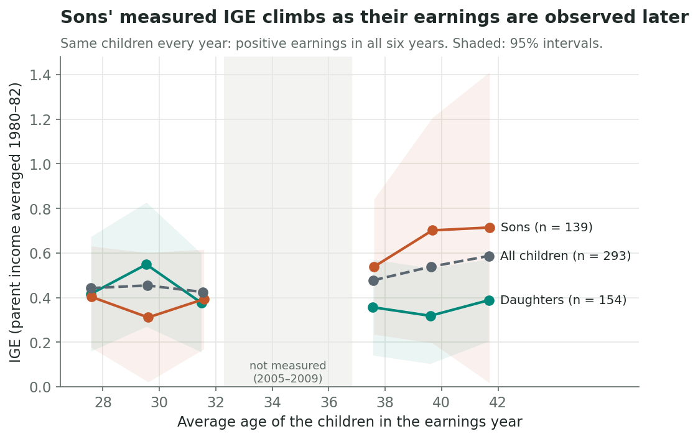

Does a richer childhood relate differently to daughters' and sons' adult earnings? To find out, you first have to connect the generations. In this tutorial you'll use **SQL inside Python** to link children to their mothers in the [Panel Study of Income Dynamics (PSID)](https://psidonline.isr.umich.edu/), build income histories for both, and estimate the **intergenerational elasticity (IGE)**:

$$\log(\text{child income}) = \alpha + \beta\,\log(\text{parent income}) + \varepsilon$$

An IGE of 0.4 means children whose parents earned 10% more earn about 4% more as adults. Higher means more persistence, less mobility. You'll see that the estimate depends on *how many years* and *at what age* you measure income.

**You need:** basic Python, pandas and SQL. `sqlite3` ships with Python.

## 1. Load the data into SQLite

You need two free PSID files: a Data Center extract of  people (IDs, sex, birth year, weights, family membership and income for 1981–83, 2001–05 and 2011–15) and the Parent Identification File, which lists each person's birth mother and father. The [README](https://github.com/lizzyuan77/lizzyuan-s-website/blob/main/blog/posts/post6/README.md) lists every variable to request. `code/01_import.py` turns them into five tables:

```python
import sqlite3, pandas as pd
con = sqlite3.connect("data/working/blog6.sqlite")
```

| Table | One row per | Key |
|---|---|---|
| `people` | person | `id68, pn` |
| `parent_links` | child × parent | `child_id68, child_pn` |
| `membership` | person × interview | `id68, pn, wave` |
| `family_income` | family × interview | `wave, family_id` |
| `cpi` | year | `year` |

Two identifier rules matter. A person is identified by the **pair** `(id68, pn)`; neither number is unique alone. A `family_id` is reassigned **every interview**, so it only means something together with `wave`.

## 2. Match children to mothers with SELECT and JOIN

Join `people` to itself, once as the child (`c`) and once as the mother (`p`):

```sql
SELECT c.id68 AS child_id68, c.pn AS child_pn, c.sex, c.weight,
       p.id68 AS parent_id68, p.pn AS parent_pn
FROM people AS c
JOIN parent_links AS l
  ON c.id68 = l.child_id68 AND c.pn = l.child_pn
 AND l.parent_type = 'birth_mother'
JOIN people AS p
  ON p.id68 = l.parent_id68 AND p.pn = l.parent_pn
WHERE c.birth_year BETWEEN 1970 AND 1974;
```

`SELECT` picks the columns, with aliases to tell child from mother apart. `JOIN ... ON` matches on **both** parts of the ID. `WHERE` keeps children born 1970–74. This returns ** children**. A `LEFT JOIN` version of the same query (in `02_match.sql`) counts the children whose link fails.

On a fictional example, the output looks like this:



## 3. Attach income, joining on wave *and* family

For each childhood interview (1981–83, about income years 1980–82), keep the family income only if the child and mother lived in the **same family that year**. Convert it to 2020 dollars with the BLS [CPI-U](https://www.bls.gov/cpi/data.htm) for the *income* year:

```sql
SELECT pr.child_id68, pr.child_pn, f.income_year,
       f.total_income * (SELECT cpi FROM cpi WHERE year = 2020) / k.cpi AS real_income
FROM pairs AS pr
JOIN membership AS mc ON mc.id68 = pr.child_id68 AND mc.pn = pr.child_pn
                     AND mc.wave IN (1981, 1982, 1983) AND mc.current_member = 1
JOIN membership AS mp ON mp.id68 = pr.parent_id68 AND mp.pn = pr.parent_pn
                     AND mp.wave = mc.wave AND mp.family_id = mc.family_id
JOIN family_income AS f ON f.wave = mc.wave AND f.family_id = mc.family_id
JOIN cpi AS k ON k.year = f.income_year;
```

Children's adult labor earnings (2000–04 and 2010–14) are built the same way. A `CASE` expression takes the reference-person or spouse earnings field according to each person's role that year.

## 4. Aggregate first with GROUP BY

Each child now has three parent years and three adult years. Joining them directly pairs every year with every other: on the real data, ** rows for  children**, nine each. Collapse each generation to one row per child first:

```sql
SELECT child_id68, child_pn,
       AVG(real_income) AS parent_mean,
       MAX(CASE WHEN income_year = 1981 THEN real_income END) AS parent_single
FROM parent_history
GROUP BY child_id68, child_pn
HAVING COUNT(real_income) = 3;
```

`GROUP BY` makes one group per child. The aggregate `AVG` collapses the group to its mean, and `MAX(CASE ...)` pulls out the 1981 value. `HAVING` filters *groups*, keeping children with all three years. The same query on 2010, 2012 and 2014 gives `child_mean` and `child_single` (2012). Joining the two summaries leaves one row per child.



*Fictional output: Cleo's family had a bad 1981, which drags her single-year value far below her average.*

After requiring positive incomes and a valid 2015 longitudinal weight, ** daughters and  sons** remain. Most losses come from children not interviewed in all of 2011–15 (full counts in `results/sample_flow.csv`).

## 5. Estimate the IGE: one year vs. three

Fit a weighted log–log regression on the **same children** with each income measure (full code with standard errors clustered by mother in `04_estimate.py`):

```python
def fit_ige(d, child_col, parent_col):
    y = np.log(d[child_col]); x = np.log(d[parent_col]); w = d["weight"]
    xm, ym = np.average(x, weights=w), np.average(y, weights=w)
    return np.sum(w * (x - xm) * (y - ym)) / np.sum(w * (x - xm) ** 2)
```

{fig-alt="Single-year and three-year-average IGE estimates with 95% intervals for daughters, sons and all children."}

Averaging raises the IGE for daughters ( → ) and slightly for all children ( → ), but not for sons ( → ). With about 200 children per group, the intervals are wide.

**Why averaging helps.** Any year's income is long-run status plus temporary luck. Here, a family's log income in 1980 and 1982 correlates at only . Noise in the *parent's* income acts like measurement error in a regressor and pulls the slope toward zero. An average cancels part of that noise. The data contain an extreme case: one son's family income for 1980 and 1981 is PSID's $1 code, meaning "$1 or less, including zero and negative." Read it as a real $1 income, and that one family moves the sons' single-year IGE from  to . The three-year averages are unchanged ( either way).

{fig-alt="For sons, the single-year IGE changes sharply with how one bottom-coded income is treated; the three-year-average IGE does not."}

## 6. Watch for life-cycle bias

Averaging fixes noise, not **timing**. High earners often start low and grow fast, so earnings at 28 understate how tied children's incomes are to their parents'. Follow the same  children across six years, holding parental income fixed:

{fig-alt="IGE by children's average age for the same children. Sons and all children rise from the late twenties to the early forties; daughters do not."}

Sons' IGE rises from  at age  to  at age . Measure at 28 and you would overstate their mobility. Daughters show no rise ( to ), likely because women's own earnings around 40 also reflect hours and participation choices. The daughters' averaged IGE is  lower than the sons' (95% bootstrap interval  to ).

## Takeaways

- **SQL makes the match explicit.** Join on the two-part person key, join family data on `wave` *and* `family_id`, and `GROUP BY` before joining generations.
- **One year is a noisy snapshot.** Averaging cancels temporary shocks and makes the estimate robust to a single bad record.
- **Age matters too.** Measured around 30, sons look far more mobile than they are by 40.

**Try it:** change `'birth_mother'` to `'birth_father'` in `02_match.sql` and re-run.

## Data and code

**Data:** PSID public-use data (Survey Research Center, University of Michigan, 2026), Data Center extract and Parent Identification File (2023); BLS CPI-U annual averages. **Code and results:** [`code/`](https://github.com/lizzyuan77/lizzyuan-s-website/tree/main/blog/posts/post6/code) and [`results/`](https://github.com/lizzyuan77/lizzyuan-s-website/tree/main/blog/posts/post6/results); run `00`–`06` in order (see the [README](https://github.com/lizzyuan77/lizzyuan-s-website/blob/main/blog/posts/post6/README.md)). [research.zip](research.zip) has everything except PSID microdata, which cannot be redistributed.
