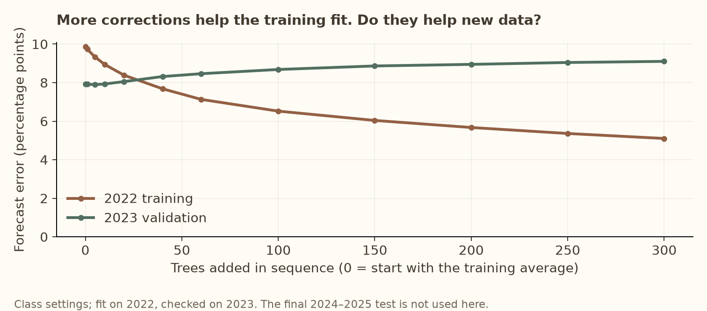
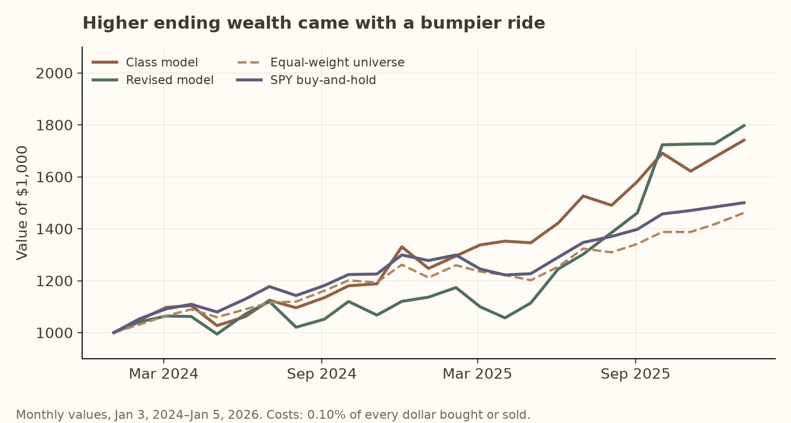

In class, we used **gradient boosting** to predict stock returns from past prices, trading volume, and volatility. The central idea is simple: improve a forecast by repeatedly correcting its mistakes. **When do those corrections help—and when do they just memorize the past?**

Following Class 21’s boosting lesson, I demonstrate the learning process, revise the class stock model, and compare both versions with simple benchmarks on unseen data.

## How one tree becomes a boosting model

A **decision tree** asks yes/no questions, such as whether a stock’s recent price growth is above a cutoff. These questions divide stocks into groups with similar characteristics.

The model starts by predicting the training-period average return. Each new tree learns the remaining errors—called **residuals**—and adds a small correction. Try the process below.



Notice that the new tree predicts **errors**, not returns. We add its correction to the existing forecast. The learning rate controls how much we add: 0.5 takes half the suggested step. Change it and restart to compare.

The trees therefore work in sequence. Later trees improve the combined prediction; they do not replace it. XGBoost, the class software, adds penalties that discourage overly complicated corrections.

## Watch the model learn—and overfit

The graph adds trees to the class setup, fitting on **2022** and checking predictions on **2023**, a separate validation year. Lower error is better. At zero trees, the prediction is just the training average.

The training line keeps falling, but the validation line rises after the first few trees. This is **overfitting**: increasingly detailed corrections fit the known observations while becoming less useful on new ones. More trees are not automatically better.

This also explains the course’s main controls. **Depth** limits how many questions a tree can ask along one path. The **learning rate** controls the size of each update. **Tree count** controls how often we update. Smaller steps may require more trees; these controls should be chosen together.

## Revise the class stock experiment

I retained the supplied list’s **95 stocks** and roughly one-month prediction target. The class setup uses 300 trees, depth five, and a 0.05 learning rate.

The revision uses shallower trees, a 0.03 learning rate, and stronger penalties. It replaces raw dollar prices with relative signals, such as a stock’s growth ranking among its peers. Eight candidate settings were compared using **2023 only**, selecting 200 trees with depth two.

Both models were then trained on available 2022–2023 outcomes and tested on **2024–2025**. Training outcomes ending in the test period were excluded. This is a documented Python implementation of the class settings, not an exact replay of the R run.

## Do the corrections help on unseen data?

The error score, which gives extra weight to large misses, falls from ** to  percentage points**. Yet simply predicting the training-period average scores ** points**. The revision barely beats that benchmark. Stock returns contain enough noise and changing relationships that fitting past patterns does not guarantee accurate forecasts.

For investment performance, both models select ten stocks in equal amounts each month, trading at the next day’s close. The comparison charges **0.10% per dollar bought or sold**, including initial purchase and final sale. All strategies use the same holding dates, ending January 5, 2026.



The revised portfolio finishes ahead, but its **% annualized volatility** is roughly twice SPY’s **%**. Volatility measures how much returns fluctuate. With only 24 monthly holdings and a retrospectively chosen stock list, higher returns are not proof of dependable skill.

**Boosting learns through sequential corrections; validation tells us when those corrections stop helping.** A useful model must also beat simple forecasts and justify its investment risk and trading costs.

Our separate group portfolio, which did not use XGBoost, fell % over its exported August–November 2026 history.

[Code, data, course references, and replication instructions](research.zip). Visual teaching inspiration: [3Blue1Brown’s gradient-descent lesson](https://www.3blue1brown.com/lessons/gradient-descent/), which explains learning in neural networks; the example above demonstrates boosting trees.
